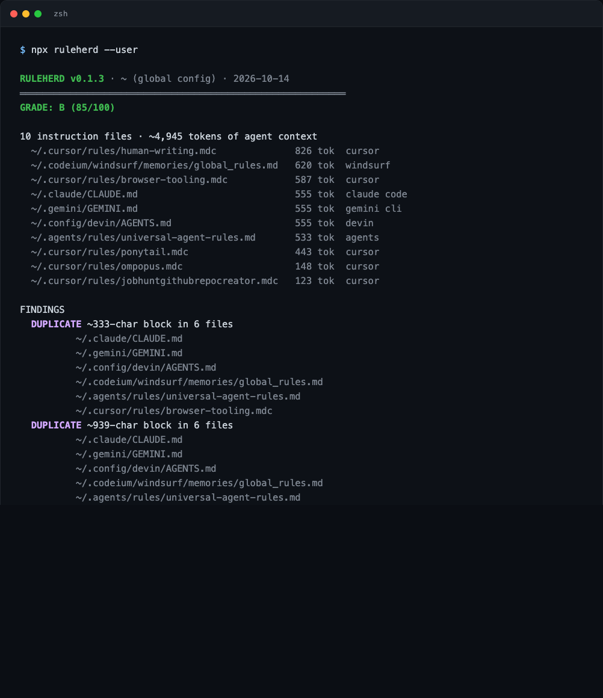

# ruleherd

**`npx ruleherd` audits the agent instruction files you already have: contradictions, dead references, and copy-pasted rules that drifted apart.**



Every agent tool wants its own config file. `CLAUDE.md`, `AGENTS.md`, `.cursor/rules/`, `.windsurfrules`, `.github/copilot-instructions.md`, `GEMINI.md`. You write the rule once, paste it into five places, and six months later they disagree. ruleherd reads whatever is already on disk and tells you where the files stopped matching, instead of asking you to adopt yet another format.

```bash
npx ruleherd            # audit the repo in cwd (or pass a path)
npx ruleherd --user     # audit your global config (~/.claude, ~/.cursor, ...)
npx ruleherd --json     # machine-readable
npx ruleherd --strict   # exit 1 on any finding, for CI
```

Zero dependencies. Node 18+.

## What it checks

| finding | what it means |
|---|---|
| `CONFLICT` | one file says tabs, another says spaces. one says `npm`, another says `pnpm`. one says "never push to main", another says "always push". keyword-pair tables plus never/always polarity on shared topics. |
| `DEAD REF` | a backticked path or `@import` pointing at a file that does not exist. |
| `DEAD CMD` | `npm run x` where no `package.json` in the repo has an `x` script. |
| `DUPLICATE` | the same paragraph pasted into multiple rule files. a conflict waiting to happen. |
| `STALE` | the rules say `react 17` but `package.json` installs react 19. version mentions checked against installed majors. |
| `DEAD GLOB` | a cursor `.mdc` / copilot instruction file whose `globs:` prefix points at a deleted directory, so the rule silently never loads. |
| `BLOAT` | one file is ~4k+ tokens. it loads into every prompt whether it helps or not. |
| `MISSING` | you maintain rules but have no `AGENTS.md`, the file 30+ agents can read. |

Score out of 100, letter grade, per-file token estimate so you can see what each file costs in context.

## Real output

This is `ruleherd --user` on my own machine. I keep one universal rules file synced into five tool-specific locations by hand:

```
RULEHERD v0.1.0 · ruleherd · 2026-10-14
══════════════════════════════════════════════════════════
GRADE: B (85/100)

9 instruction files · ~4,757 tokens of agent context
  ~/.cursor/rules/human-writing.mdc            826 tok  cursor
  ~/.cursor/rules/browser-tooling.mdc          587 tok  cursor
  ~/.claude/CLAUDE.md                          555 tok  claude code
  ~/.gemini/GEMINI.md                          555 tok  gemini cli
  ~/.config/devin/AGENTS.md                    555 tok  devin
  ~/.codeium/windsurf/memories/global_rules.md 555 tok  windsurf
  ~/.agents/rules/universal-agent-rules.md     533 tok  agents
  ~/.cursor/rules/ponytail.mdc                 443 tok  cursor
  ~/.cursor/rules/ompopus.mdc                  148 tok  cursor

FINDINGS
  DUPLICATE ~333-char block in 6 files
  DUPLICATE ~939-char block in 6 files
  DUPLICATE ~705-char block in 6 files
          ~/.claude/CLAUDE.md
          ~/.gemini/GEMINI.md
          ~/.config/devin/AGENTS.md
          ~/.codeium/windsurf/memories/global_rules.md
          ~/.agents/rules/universal-agent-rules.md
          ~/.cursor/rules/browser-tooling.mdc
```

The sync drifted anyway. That is the entire point of the tool.

## Limitations

- Contradiction detection is heuristic. It catches keyword pairs (npm/pnpm, tabs/spaces, jest/vitest, ESM/CJS) and never/always polarity on shared topics like `commit`, `push`, `test`. Two files can disagree semantically in ways a regex cannot see. A clean grade means "no detectable drift", not "your rules are good".
- Fenced code blocks are treated as examples, not rules: paths and commands inside ` ``` ` fences are not checked.
- Dead-ref checking is deliberately conservative. Bare filenames in backticks like `index.ts` are usually examples in prose, so only slashed paths and canonical filenames get checked. Some flagged refs may still be intentional examples; check them before deleting.
- `DEAD CMD` checks every `package.json` found within depth 3 of the repo root, not just the top one. `pnpm install` and other builtin subcommands are not scripts and are never flagged.
- The `STALE` version check only knows a fixed list of packages (react, next, vue, svelte, angular, tailwind, typescript, node, prisma, zod, vite).
- Token estimate is chars/4. Ballpark, not your provider's tokenizer.
- `--user` covers the global paths I could verify on macOS/Linux. PRs for more locations welcome.
- Grade weights are tuned by feel, not data. They are in `bin/ruleherd.mjs` if you want different ones.

## License

MIT
